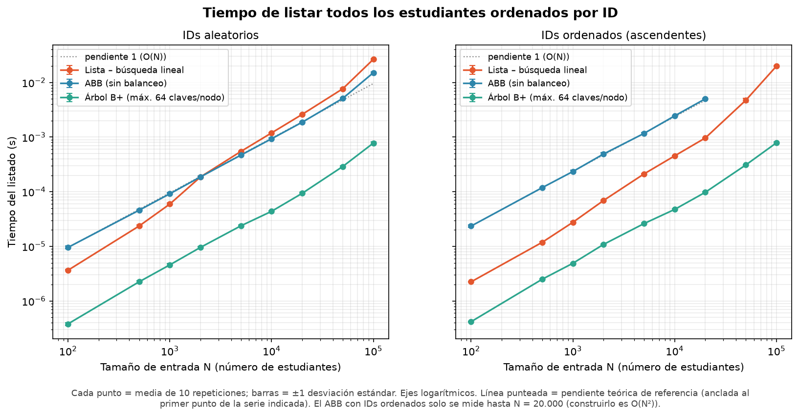
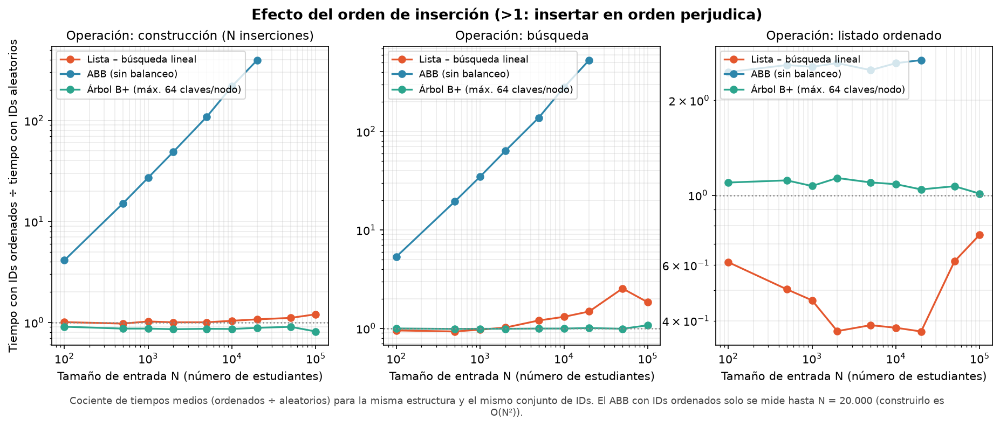
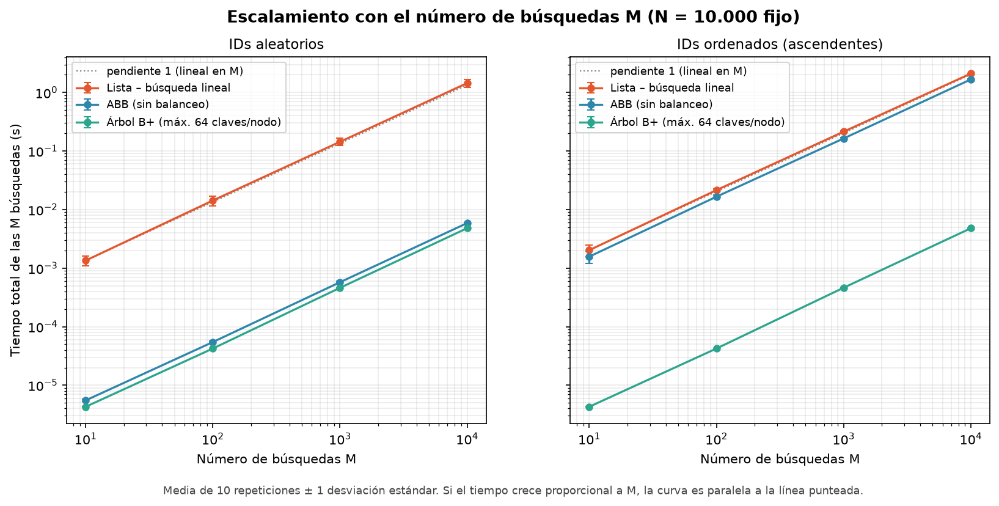
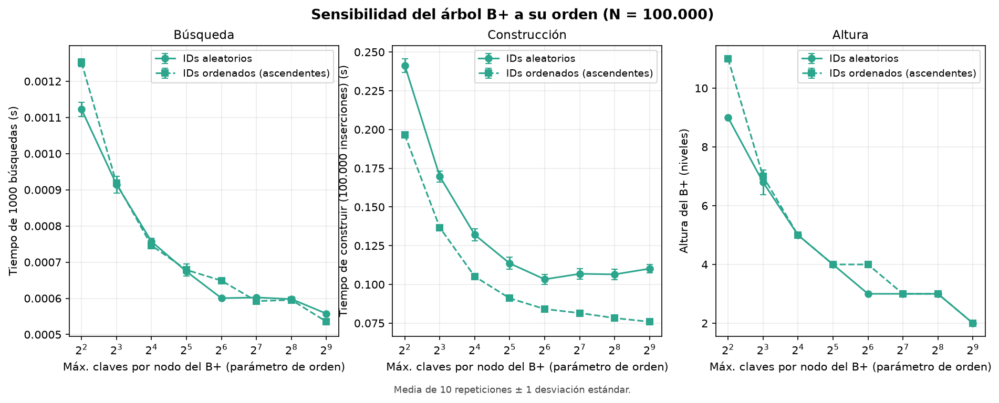

# Laboratorio 3 — Juan Manuel Moscoso Torres 

Estudio experimental de cómo escala el tiempo de ejecución de tres estrategias de almacenamiento y búsqueda
(**Lista**, **Árbol Binario de Búsqueda (ABB)** y **Árbol B+**) cuando crece el número de estudiantes `N`, y de cómo
influye el orden de inserción de los IDs (aleatorio vs ordenado).

## Código de honor - Uso de Inteligencia Artificial

Para desarrollar este laboratorio utilicé herramientas de inteligencia artificial como apoyo de programación,
organización y revisión. Todo el código fue generado con ayuda de IA, pero la ejecución, revisión y responsabilidad
por los resultados son mías.

**Claude (Anthropic)** me dio la base inicial de las estructuras, los experimentos y el análisis. Después utilicé **GitHub Copilot** para corregir, integrar y perfeccionar la solución de este laboratorio, especialmente las pruebas, la metodología de medición, y la generación final de resultados.

Mi responsabilidad fue verificar que:

1. Los datos utilizados fueran reales y provinieran de ejecuciones locales del programa;
2. Los cálculos estadísticos fueran correctos;
3. Las gráficas representaran correctamente los datos de los archivos CSV;
4. Las conclusiones correspondieran a los resultados obtenidos.

## 1. Contenido del repositorio

```
.
├── README.md                    <- este archivo + declaración de honor y de uso de herramientas de IA
├── requirements.txt
├── src/
│   ├── estructuras.py           <- Lista, ABB y B+ (implementación propia)
│   ├── test_estructuras.py      <- pruebas de correctitud (correr ANTES de medir)
│   ├── config.py                <- todos los parámetros del estudio (N, M, repeticiones, semilla, ...)
│   ├── entorno.py               <- captura automática de hardware y software
│   ├── experimentos.py          <- genera datos, mide tiempos y guarda resultados/*.csv
│   └── analisis.py              <- estadística, gráficas e informe con tablas
├── resultados/                  <- CSV crudos, CSV resumen, entorno.json, informe_generado.md
└── graficas/                    <- 11 gráficas PNG (YA generadas)
```

## 2. El problema

Cada estudiante es un registro `{id, nombre, edad, promedio}`. El sistema debe permitir:

1. **Buscar** un estudiante por su ID.
2. **Insertar** un nuevo estudiante.
3. **Listar** todos los estudiantes en orden ascendente de ID.

Objetivo: medir experimentalmente (con estadística) cómo cambia el rendimiento de cada estructura al aumentar `N` y `M`
(número de búsquedas), y contrastar los resultados con la complejidad teórica.

## 3. Cómo reproducir los experimentos

Requiere Python 3.10+ (probado en CPython 3.11.9). Desde la raíz del repositorio:

```bash
python -m venv .venv
# Windows:  .venv\Scripts\activate        Linux/Mac:  source .venv/bin/activate
pip install -r requirements.txt

python src/test_estructuras.py          # 1) las 3 estructuras son correctas (segundos)
python src/experimentos.py --rapido     # 2) (opcional) prueba de humo, ~1 min, NO sirve para el informe
python src/experimentos.py              # 3) experimento completo (decenas de minutos, ver abajo)
python src/analisis.py                  # 4) gráficas + tablas + informe en resultados/
```

Con el PC conectado a la corriente, sin navegadores y otras aplicaciones. Se ejecuta el Script sin usar el equipo. El script no lee ni escribe en disco dentro de las secciones cronometradas.

Tiempo aproximado del paso 3: la corrida completa corregida tardó 43,7 minutos en el equipo usado. El tiempo depende
del hardware y de la ventana mínima de 1 segundo aplicada a cada medición. Se puede ejecutar un solo experimento con
`--exp 1`, `--exp 2` o `--exp 3`.

Los datos aleatorios son **reproducibles**: la semilla base está en `src/config.py` (`semilla`). Con la misma semilla se
generan exactamente los mismos IDs y las mismas consultas; lo que cambia entre equipos son los tiempos.

El perfil `--rapido` es únicamente una prueba funcional. Sus resultados no deben mezclarse con los resultados completos
ni usarse para sustentar conclusiones. El informe incluido en este repositorio fue generado leyendo los CSV de
`resultados/`, no contiene tiempos escritos manualmente.

## 4. Metodología experimental

### 4.1 Estructuras y complejidad teórica

| Estructura | Buscar | Insertar | Listar en orden |
|---|---|---|---|
| Lista | O(N), recorrido lineal | O(1) amortizado | O(N log N), al ordenar una copia |
| ABB sin balanceo | O(log N) promedio; O(N) si se degenera | O(log N) promedio; O(N) si se degenera | O(N), recorrido inorden |
| B+ | O(log N), con nodos de hasta 64 claves | O(log N) amortizado, con división de nodos | O(N), recorriendo hojas enlazadas |

El ABB permite observar el efecto del orden de inserción: con IDs aleatorios suele conservar una altura
moderada, pero con IDs ordenados se convierte en una estructura degenerada. El B+ conserva el balance y
mantiene una altura pequeña en ambos escenarios.

### 4.2 Hardware y software

La medición se realizó localmente en memoria RAM, sin leer ni escribir archivos dentro de las secciones
cronometradas:

- CPU: AMD Ryzen 7 5800X, 8 núcleos físicos y 16 lógicos.
- RAM: 31,9 GB.
- Sistema operativo: Windows-10-10.0.26300-SP0.
- Python: CPython 3.11.9.
- Librerías: NumPy 2.4.6, pandas 3.0.6 y Matplotlib 3.11.2.
- Tipo de equipo: PC de escritorio.

La información completa se conserva en [resultados/entorno.json](./resultados/entorno.json).

### 4.3 Parámetros de los experimentos

| Parámetro | Valores o condición | Propósito |
|---|---|---|
| `N` | 100, 500, 1.000, 2.000, 5.000, 10.000, 20.000, 50.000 y 100.000 | Observar la escala desde entradas pequeñas hasta grandes |
| `M` principal | 1.000 búsquedas | Reducir el ruido relativo de búsquedas muy cortas |
| `M` variable | 10, 100, 1.000 y 10.000, con `N = 10.000` | Analizar el crecimiento según la cantidad de consultas |
| Orden de inserción | IDs aleatorios y IDs ascendentes | Medir la degeneración del ABB |
| Repeticiones | 10 por configuración | Calcular variabilidad e intervalos de confianza |
| Orden del B+ | 4, 8, 16, 32, 64, 128, 256 y 512 | Analizar el efecto de las claves por nodo |
| Límite del ABB ordenado | `N ≤ 20.000` | Evitar un costo O(N²) impracticable |

### 4.4 Generación de datos y consultas

Para cada tamaño se generan IDs únicos mediante `random.sample()` en el rango `[1, 10N]`. Esto deja
huecos en las matrículas y permite representar un conjunto más realista. Cada registro contiene ID,
nombre, edad y promedio.

Los escenarios aleatorio y ordenado utilizan exactamente los mismos registros; únicamente cambia el
orden de inserción. Las consultas se eligen con reemplazo entre IDs existentes y son las mismas para
las tres estructuras. Las semillas se derivan de una semilla base, por lo que los datos son reproducibles.

### 4.5 Medición y estadística

- Se utiliza `time.perf_counter_ns()`.
- Se realizan tres calentamientos antes de medir.
- El recolector de basura se desactiva durante cada medición.
- Cada construcción, lote de búsquedas y listado se calibra para superar una ventana mínima de 1 segundo
  en el perfil completo.
- Las configuraciones se ejecutan en orden aleatorio reproducible para reducir sesgos por carga del equipo.
- Se calculan media, desviación estándar muestral, mediana, mínimo, máximo, coeficiente de variación,
  intervalo de confianza del 95 % y valores atípicos mediante el criterio de Tukey.

### 4.6 Calibración de las mediciones

La ventana mínima de 1 segundo evita que una interrupción breve del sistema operativo tenga un peso
desproporcionado en una operación muy rápida. Cada medición se ejecuta primero como calentamiento y
después se repite en bloques hasta superar esa ventana. El tiempo total se divide entre el número de
bloques para obtener el costo medio equivalente de una construcción, un lote de búsquedas o un listado.

Las verificaciones de resultados, el cálculo de la altura y los pasos medios no forman parte del tiempo
cronometrado. Los archivos CSV se escriben únicamente después de terminar la medición y todas las
estructuras permanecen en memoria durante el cronómetro.

El perfil `--rapido` usa una ventana de 0,05 segundos y sirve únicamente para comprobar el funcionamiento
del programa. No se utiliza para las conclusiones finales.

### 4.7 Verificación de correctitud

Antes de aceptar una medición se comprueba que:

1. Las tres estructuras contienen exactamente los `N` registros esperados.
2. Todas las consultas generadas encuentran un estudiante existente.
3. `listar()` devuelve todos los registros en orden ascendente de ID.
4. Las inserciones duplicadas producen el comportamiento esperado.
5. El B+ conserva sus invariantes: claves ordenadas, cantidad válida de hijos, hojas al mismo nivel y
   cadena de hojas enlazadas en orden.

Estas comprobaciones también se ejecutan en [test_estructuras.py](./src/test_estructuras.py), que compara
las estructuras con un diccionario como oráculo usando tamaños pequeños y medianos, inserciones aleatorias,
ascendentes y descendentes, búsquedas intercaladas y diferentes órdenes del B+.

### 4.8 Estadística y contraste con la teoría

Para cada combinación de escenario, estructura, tamaño y operación se resumen las 10 repeticiones:

| Medida | Interpretación |
|---|---|
| Media | Valor central usado principalmente en las gráficas |
| Desviación estándar muestral | Variabilidad entre repeticiones |
| IC del 95 % | Incertidumbre de la media, calculada como `t(n-1) · s / √n` |
| Mediana, mínimo y máximo | Comportamiento central robusto y rango observado |
| Coeficiente de variación | Variabilidad relativa, `s / media` |
| Atípicos de Tukey | Valores fuera de `[Q1 - 1,5·IQR, Q3 + 1,5·IQR]` |

Los atípicos se cuentan y se reportan; no se eliminan automáticamente. También se compara la media
original con la mediana y con la media sin atípicos. Con 10 observaciones, el criterio de Tukey se usa
como señal de alerta y no como una prueba definitiva.

El análisis estima pendientes en escala log-log y compara modelos descriptivos O(1), O(log N), O(N),
O(N log N) y O(N²). También calcula tiempos normalizados por la función teórica, relaciones de aceleración
frente a la Lista y penalizaciones entre inserción ordenada y aleatoria. Estos ajustes describen los datos;
no pretenden demostrar formalmente una complejidad matemática.

### 4.9 Reproducibilidad

Los parámetros principales se encuentran en [config.py](./src/config.py) y la semilla base es fija.
Las semillas de cada repetición se derivan de la semilla base, `N` y el número de repetición. Por eso
los IDs, estudiantes y consultas pueden reproducirse con el mismo código y versión de Python, aunque los
tiempos absolutos cambien entre equipos.

El entorno se guarda en [entorno.json](./resultados/entorno.json), los datos crudos en `resultados/*.csv`
y los resúmenes, gráficas e informe se regeneran con:

```powershell
python src/analisis.py
```

## 5. Experimentos realizados

### 5.1 Experimento 1: escalamiento con `N`

Se varía `N`, el orden de inserción y la estructura. Se miden el tiempo de construcción, 1.000 búsquedas,
el listado ordenado, la altura y los pasos medios de búsqueda.

### 5.2 Experimento 2: escalamiento con `M`

Se mantiene `N = 10.000` y se comparan lotes de 10, 100, 1.000 y 10.000 búsquedas. El valor `M = 100`
corresponde directamente al caso solicitado en el enunciado.

### 5.3 Experimento 3: orden del árbol B+

Se mantiene `N = 100.000` y se varía el máximo de claves por nodo entre 4 y 512 para observar el efecto
del orden sobre el tiempo de búsqueda, construcción y altura.

## 6. Entorno de ejecución

El script guarda automáticamente el hardware y software usados en [entorno.json](./resultados/entorno.json)
y en la sección 2 de [informe_generado.md](./resultados/informe_generado.md).

| Elemento | Valor |
|---|---|
| Equipo | PC de escritorio |
| CPU | AMD Ryzen 7 5800X 8-Core Processor |
| RAM | 32 GB registrados por el entorno |
| Sistema operativo | Windows-10-10.0.26300-SP0 |
| Python y librerías | CPython 3.11.9; NumPy 2.4.6; pandas 3.0.6; Matplotlib 3.11.2 |
| Condiciones | Ejecución local en RAM; el script recomienda cerrar aplicaciones pesadas; se usó un PC de escritorio |

## 7. Resultados y gráficas

Las tablas numéricas completas están en [resultados/informe_generado.md](./resultados/informe_generado.md).
Cada gráfica se muestra directamente junto con la pregunta que ayuda a responder.

### 7.1 ¿Cómo cambia la búsqueda al aumentar `N`?


La Lista crece aproximadamente de forma lineal y se vuelve la alternativa más lenta cuando `N` aumenta.
El ABB aleatorio y el B+ crecen mucho más lentamente. El ABB ordenado solo se mide hasta `N = 20.000`
porque su construcción se vuelve cuadrática.

### 7.2 ¿Qué efecto tiene insertar los IDs ordenados?


El orden perjudica especialmente al ABB: al insertar IDs ascendentes, su altura se aproxima a `N`.
La Lista y el B+ muestran cambios menores en la búsqueda.

### 7.3 ¿Cómo escala la construcción?


La Lista mantiene un costo bajo y aproximadamente lineal. El ABB aleatorio crece de forma moderada,
mientras que el ABB ordenado evidencia la degeneración cuadrática. El B+ conserva un crecimiento
logarítmico amortizado, aunque sus divisiones de nodos agregan costo constante.

### 7.4 ¿Cómo escala el listado ordenado?



El listado debe visitar todos los registros. El B+ aprovecha la cadena enlazada de hojas y presenta
tiempos bajos; el ABB realiza un recorrido inorden y la Lista debe ordenar una copia.

### 7.5 ¿Cómo crece la altura?


El ABB aleatorio crece aproximadamente de forma logarítmica, pero el ABB ordenado alcanza una altura
igual a `N`. El B+ permanece bajo y balanceado en ambos escenarios.

### 7.6 ¿La altura explica el tiempo de búsqueda?


Los datos relacionan una mayor cantidad de pasos con un mayor tiempo. El ABB ordenado confirma que
una altura lineal elimina la ventaja esperada de un árbol de búsqueda.

### 7.7 ¿Coinciden los tiempos con la complejidad teórica?


La normalización muestra que la Lista se comporta como O(N), mientras que el ABB aleatorio y el B+
se mantienen cercanos a sus costos logarítmicos. Las constantes de Python y el uso de `bisect` en C
influyen en las diferencias absolutas.

### 7.8 ¿Cuánta aceleración ofrecen los árboles frente a la Lista?


La ventaja de ABB y B+ se hace más visible al crecer `N`. En tamaños pequeños domina el costo fijo
del intérprete; en tamaños grandes la búsqueda lineal de la Lista se convierte en el factor decisivo.

### 7.9 ¿Cuál es la penalización del orden de inserción?



La razón entre el tiempo ordenado y aleatorio crece principalmente para el ABB. Esta gráfica muestra
experimentalmente por qué un ABB sin balanceo no debe recibir datos ordenados sin una estrategia adicional.

### 7.10 ¿Cómo influye el número de búsquedas `M`?



Con `N` fijo, el tiempo total aumenta aproximadamente de forma lineal con `M`, como se espera al
repetir la misma operación un número mayor de veces.

### 7.11 ¿Cómo influye el orden del B+?



Modificar el máximo de claves por nodo cambia la altura y el costo de buscar dentro de cada nodo.
El resultado permite justificar el uso de 64 claves por nodo como un compromiso entre altura y trabajo
interno.

## 8. Verificación de resultados

Antes de aceptar una medición se ejecutan aserciones que comprueban que:

- todas las consultas encuentran un ID existente;
- las tres estructuras contienen exactamente `N` registros;
- `listar()` devuelve todos los IDs en orden ascendente;
- las invariantes del B+ se prueban exhaustivamente en `src/test_estructuras.py`.

Para auditar las salidas sin repetir el experimento:

```powershell
python src/analisis.py
```

El análisis vuelve a calcular los resúmenes, las 11 gráficas y `resultados/informe_generado.md` exclusivamente desde
los CSV crudos. Las gráficas incluidas son, por tanto, artefactos reproducibles del conjunto de datos guardado. La corrida completa tardó aproximadamente 43,7 minutos en este equipo, usando calibración de ventanas mínimas de 1 segundo y aleatorización controlada del orden de medición.

## 9. Limitaciones

- Las mediciones son de **Python (CPython) en un solo equipo**; sirven para comparar tendencias y proporciones, no para predecir tiempos en otros lenguajes o máquinas.
- El B+ usa `bisect` (escrito en C) dentro de cada nodo (`usar_bisect_bplus=True` en `config.py`); la Lista y el ABB son Python puro. Parte de la ventaja absoluta del B+ puede deberse a esto.
- Todo ocurre en memoria RAM: no se mide la ventaja real de un B+ (menos accesos a disco).
- El ABB con IDs ordenados solo se mide hasta `N = 20.000` porque construirlo es O(N²).
- Todas las búsquedas son por IDs existentes; no se mide la búsqueda fallida.
- Los tiempos absolutos no se pueden extrapolar directamente a otros equipos, lenguajes o implementaciones.
- La rejilla de tamaños es finita; cualquier punto de cambio observado depende de los valores de `N` medidos.
- La caché, la localidad de memoria y el ruido del sistema operativo pueden modificar los tiempos por operación,
  aunque no cambien la complejidad esperada.
- Cada medición del perfil completo se calibra a una ventana mínima de 1 segundo (`minimo_s` en `src/config.py`). El
  perfil rápido usa 0,05 segundos y no debe usarse para las conclusiones finales.
