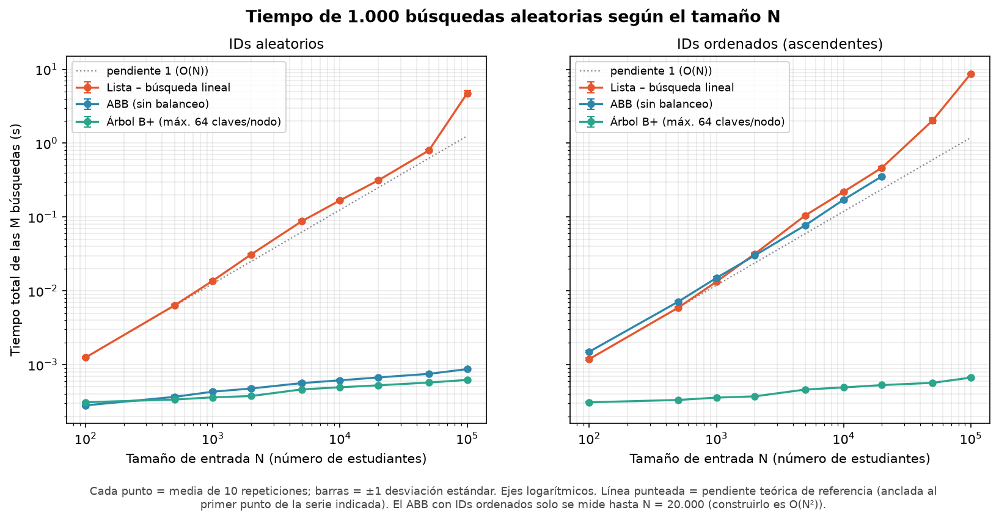
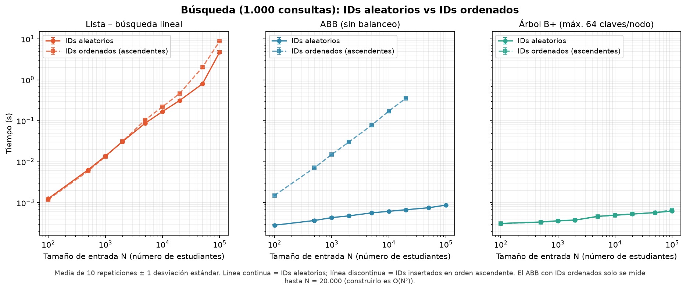
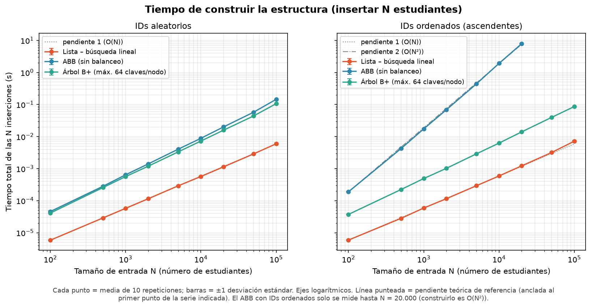
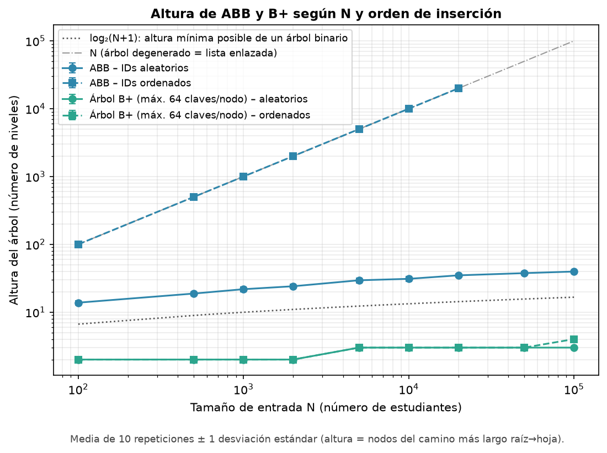
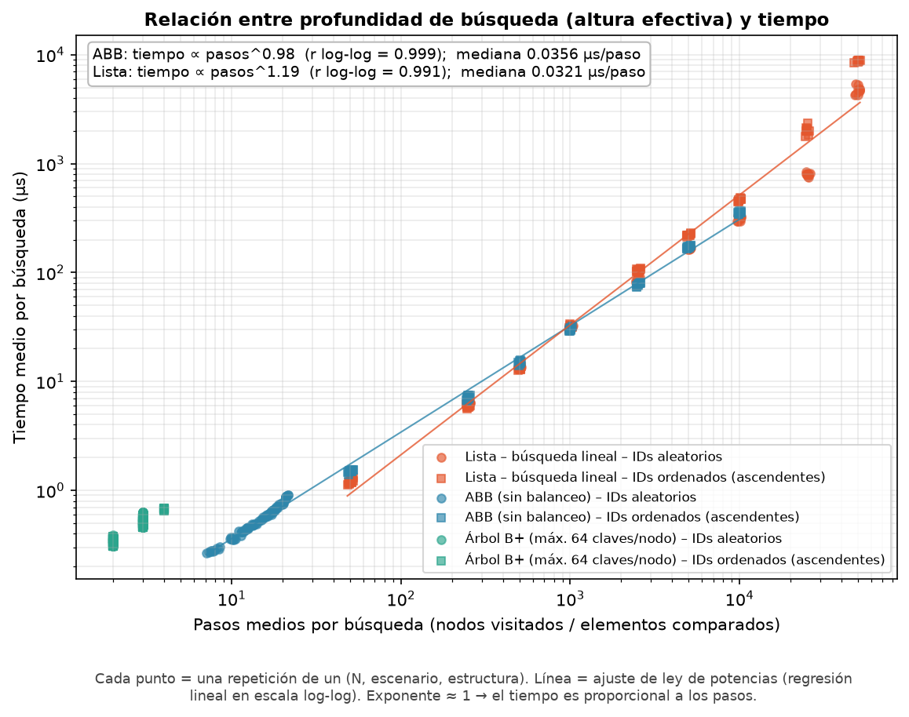
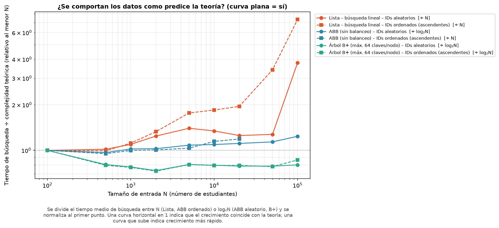
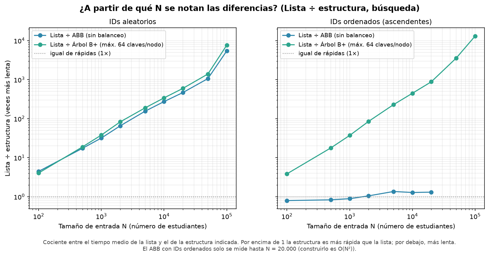

# Material de apoyo para la sustentación – Laboratorio 3

Este documento resume el problema, el diseño del experimento, los resultados principales y las conclusiones. El detalle completo está en el [README](../README.md), las tablas en [resultados/informe_generado.md](../resultados/informe_generado.md) y los datos crudos en `resultados/*.csv`.

---

## 1. Resumen en una página

**Problema.** Un sistema debe administrar estudiantes `{id, nombre, edad, promedio}` y permitir (1) buscar por ID, (2) insertar y (3) listar en orden ascendente de ID.

**Pregunta central.** ¿Cómo escala el tiempo de ejecución de tres estrategias de almacenamiento y búsqueda (**Lista**, **ABB** y **B+**) cuando aumenta el tamaño de los datos `N` y el número de búsquedas `M`, y qué ocurre cuando los IDs se insertan en orden aleatorio frente a ordenado?

**Qué se hizo.** Se implementaron las tres estructuras, se verificó su correctitud con pruebas automáticas y se midieron tiempos de construcción (N inserciones), búsqueda (M consultas) y listado ordenado, con 10 repeticiones por configuración, para `N` entre 100 y 100.000. Se calcularon media, desviación estándar, intervalo de confianza del 95 %, mediana, coeficiente de variación y valores atípicos, y se contrastaron los resultados con la complejidad teórica.

**Resultado principal.** Los tiempos siguen las tendencias teóricas: la Lista crece de forma lineal, el ABB con IDs aleatorios y el B+ crecen muy lentamente, y el ABB con IDs ordenados se degenera (altura `N`, búsqueda lineal y construcción cuadrática). Las diferencias absolutas dependen además de constantes de la implementación y del hardware.

---

## 2. Estructuras y complejidad teórica

| Estructura | Idea | Buscar | Insertar | Listar en orden |
|---|---|---|---|---|
| **Lista** | Arreglo dinámico sin ordenar | O(N) | O(1) amortizado | O(N log N) (se ordena una copia) |
| **ABB** (sin balanceo) | Menores a la izquierda, mayores a la derecha | O(altura): O(log N) con IDs aleatorios, O(N) si se degenera | O(altura) | O(N), recorrido inorden |
| **B+** (máx. 64 claves por nodo) | Registros solo en las hojas, hojas enlazadas, siempre balanceado | O(log N) con base grande | O(log N) amortizado | O(N), recorriendo las hojas |

El código está en [src/estructuras.py](../src/estructuras.py) y sus pruebas en [src/test_estructuras.py](../src/test_estructuras.py).

---

## 3. Diseño experimental

| Elemento | Descripción |
|---|---|
| **Hardware** | AMD Ryzen 7 5800X (8 núcleos físicos, 16 lógicos), 31,9 GB de RAM, PC de escritorio |
| **Software** | Windows 10, CPython 3.11.9, NumPy 2.4.6, pandas 3.0.6, Matplotlib 3.11.2 (`resultados/entorno.json`) |
| **Tamaños de entrada `N`** | 100, 500, 1.000, 2.000, 5.000, 10.000, 20.000, 50.000 y 100.000 (el ABB con IDs ordenados solo hasta 20.000 porque construirlo es O(N²)) |
| **Búsquedas `M`** | 1.000 en el experimento principal; 10, 100, 1.000 y 10.000 con `N = 10.000` en el experimento 2 |
| **Repeticiones** | 10 por configuración, con datos y consultas nuevos en cada una |
| **Generación de datos** | `N` IDs únicos con `random.sample` en `[1, 10N]`; nombre, edad (17–35) y promedio (0–10) aleatorios; semilla fija |
| **Escenarios** | IDs insertados en orden aleatorio y los **mismos** IDs en orden ascendente |
| **Generación de búsquedas** | `M` IDs existentes elegidos al azar con reemplazo; las mismas consultas para las tres estructuras |
| **Medición** | `time.perf_counter_ns()`; recolector de basura desactivado durante la medición; calentamiento; cada operación se repite hasta acumular al menos 1 s y se reporta el tiempo medio; orden de medición aleatorio reproducible |
| **Valores atípicos** | Criterio de Tukey (fuera de Q1 − 1,5·IQR y Q3 + 1,5·IQR); se cuentan y se reportan, no se eliminan (73 de 1.560 mediciones) |
| **Estadísticas** | n, media, desviación estándar muestral, IC 95 % (t de Student), mediana, mínimo, máximo, coeficiente de variación, pendiente log-log, comparación de modelos O(1)…O(N²) |

Los experimentos son: **(1)** escalamiento con `N`, **(2)** escalamiento con `M`, **(3)** sensibilidad del B+ al número máximo de claves por nodo.

---

## 4. Resultados principales

### 4.1 Búsqueda frente al tamaño `N`



Tiempo de 1.000 búsquedas con IDs aleatorios:

| N | Lista | ABB | B+ |
|---|---|---|---|
| 100 | 1,25 ms | 0,281 ms | 0,310 ms |
| 10.000 | 0,168 s | 0,614 ms | 0,494 ms |
| 100.000 | 4,75 s | 0,870 ms | 0,622 ms |

La Lista es la única que crece de forma visible con `N`; el ABB aleatorio y el B+ permanecen por debajo de 1 ms.

### 4.2 Efecto del orden de inserción



Con IDs ascendentes el ABB se degenera: con `N = 20.000` buscar es ≈ 530 veces más lento y construir ≈ 400 veces más lento que con IDs aleatorios. El B+ no cambia en búsqueda (≈ 1×). La Lista hace los mismos pasos en ambos casos, pero llega a ser hasta ≈ 2,5× más lenta con IDs ordenados; es un efecto de constantes (probablemente localidad de memoria), no de complejidad.

### 4.3 Construcción



La pendiente log-log de la construcción del ABB con IDs ordenados es **2,01** (O(N²)). Con IDs aleatorios, el ABB y el B+ tienen pendientes de 1,16 y 1,13 (compatibles con N log N). La Lista es la más rápida al insertar (solo `append`): 6 ms con `N = 100.000`, frente a 106 ms del B+ y 145 ms del ABB.

### 4.4 Altura de los árboles



La altura del ABB con IDs ordenados es exactamente `N`. La del ABB aleatorio crece de 13,8 (N = 100) a 39,7 (N = 100.000), unas 2,1–2,4 veces la altura mínima posible log₂(N+1). El B+ tiene entre 2 y 4 niveles en todo el rango.

### 4.5 Relación entre altura (pasos por búsqueda) y tiempo



El tiempo por búsqueda es proporcional al número de pasos: en el ABB, ajuste log-log con exponente 0,98 y r = 0,999 (≈ 0,036 µs por paso). Lo que determina el tiempo es la profundidad media de los IDs buscados, no la altura máxima.

### 4.6 ¿Coinciden los tiempos con la teoría?



Al dividir el tiempo entre la función teórica, una curva horizontal indica que coincide con ella. El ABB aleatorio y el B+ se mantienen casi planos (respaldan O(log N)). La Lista crece aproximadamente de forma lineal (pendiente 1,13) pero con `N` grande lo hace más rápido que O(N): su tiempo por elemento recorrido aumenta, algo coherente con efectos de memoria caché.

### 4.7 ¿Desde qué tamaño se notan las diferencias?



Con IDs aleatorios y comparando con la Lista (intervalos de confianza sin solaparse): ≥ 2× desde `N = 100`, ≥ 10× desde `N = 500` y ≥ 100× desde `N = 5.000`; con `N = 100.000` la Lista es ≈ 5.500× más lenta que el ABB y ≈ 7.600× más lenta que el B+. ABB y B+ difieren poco entre sí (≈ 1,0–1,4×).

Otras gráficas (en la carpeta [graficas/](../graficas/)): `04` listado, `09` penalización del orden de inserción, `10` búsqueda frente a `M` (pendiente 1,00–1,02: lineal en `M`) y `11` B+ según el máximo de claves por nodo (a partir de 64 claves la mejora es marginal).

---

## 5. Respuestas a las preguntas del enunciado

| Pregunta | Respuesta con los datos |
|---|---|
| ¿Los resultados se comportan como predice la complejidad teórica? | Sí en tendencia (Lista lineal; ABB aleatorio y B+ casi planos; ABB ordenado lineal en búsqueda y cuadrático en construcción). La Lista crece algo más rápido que lineal con `N` grande por efectos de memoria. |
| ¿Cuándo el árbol binario deja de comportarse como O(log N)? | Cuando el orden de inserción lo desbalancea: con IDs ascendentes la altura es `N`. |
| ¿Relación entre altura y tiempo de búsqueda? | Proporcional a los pasos por búsqueda (exponente 0,98, r = 0,999 en el ABB). |
| ¿Qué ocurre con datos insertados ordenadamente? | ABB: búsqueda ≈ 530× y construcción ≈ 400× más lentas (N = 20.000). B+: sigue balanceado (un nivel más con N = 100.000). Lista: construcción igual; búsqueda hasta ≈ 2,5× más lenta. |
| ¿Diferencias entre casos aleatorios y ordenados? | Casi solo en el ABB (gráficas 02 y 09). |
| ¿Desde qué tamaño son claramente visibles las diferencias? | Desde `N = 100` (≥ 2×), `N = 500` (≥ 10×) y `N = 5.000` (≥ 100×) entre Lista y árboles. Depende de la rejilla de `N` usada. |
| ¿Hay costos constantes que igualen algoritmos de distinta complejidad con `N` pequeño? | Sí: con `N = 100` el ABB aleatorio (0,281 ms) supera al B+ (0,310 ms); el ABB ordenado es más lento que la Lista hasta `N = 1.000` y ≈ 1,3× más rápido desde `N = 5.000`. |

---

## 6. Hallazgos principales

1. La complejidad teórica predice bien las tendencias, pero no las constantes.
2. Con IDs aleatorios, ABB y B+ son órdenes de magnitud más rápidos que la Lista desde `N` moderados.
3. El ABB sin balanceo es muy sensible al orden de inserción; el B+ no.
4. El tiempo de búsqueda en árboles se explica por el número de pasos (profundidad media).
5. Los costos constantes y la memoria caché explican diferencias que la complejidad asintótica no recoge.

---

## 7. Limitaciones

- Resultados de CPython en un solo equipo: sirven para comparar tendencias y proporciones, no tiempos absolutos en otros lenguajes o máquinas.
- El B+ usa `bisect` (escrito en C) dentro de cada nodo; la Lista y el ABB son Python puro.
- Todo ocurre en RAM: no se mide la ventaja del B+ en disco.
- ABB con IDs ordenados medido solo hasta `N = 20.000`; `N` máximo de 100.000; solo búsquedas de IDs existentes.
- Cada operación se mide en régimen estable (repetida hasta acumular 1 s); la explicación por memoria caché es una hipótesis no medida directamente.

---

## 8. Cómo reproducir

```bash
python -m venv .venv
pip install -r requirements.txt
python src/test_estructuras.py     # correctitud
python src/experimentos.py         # experimento completo (~44 min en el equipo usado)
python src/analisis.py             # gráficas, tablas e informe (segundos, a partir de los CSV)
```

Las gráficas y los CSV ya están en el repositorio; `python src/analisis.py` los regenera sin repetir los experimentos.

---

## 9. Uso de herramientas de IA

El código se desarrolló con ayuda de Claude (base de estructuras, experimentos y análisis) y GitHub Copilot (ajustes de pruebas y metodología de medición). Los experimentos se ejecutaron en el equipo del estudiante, y los datos, los cálculos, las gráficas y las conclusiones fueron revisados por él. Ver la declaración completa en el [README](../README.md).
