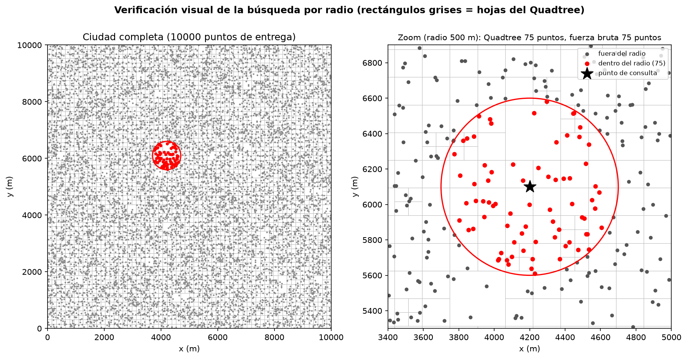
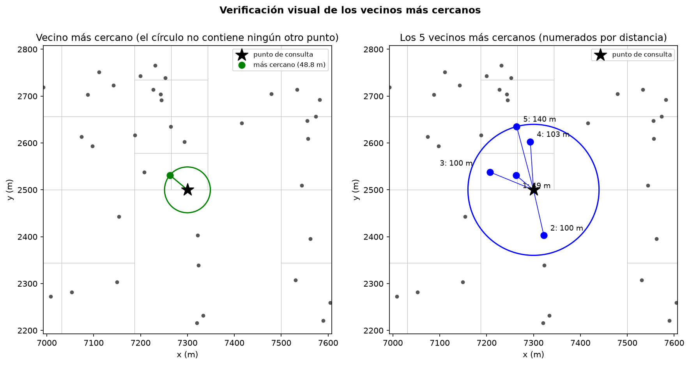
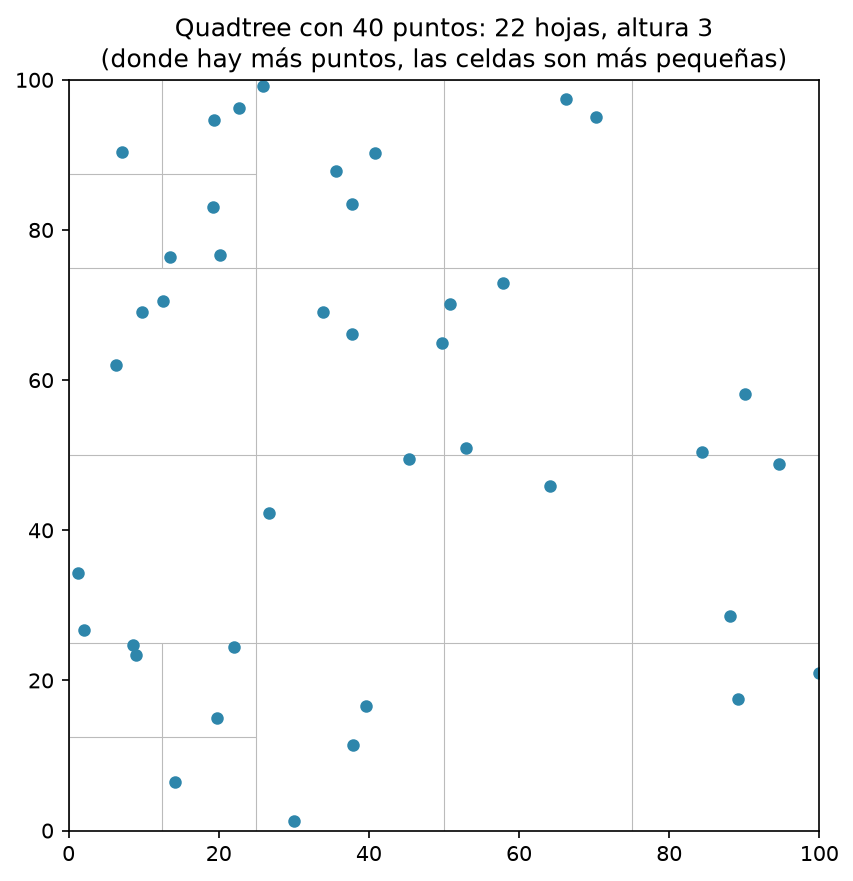
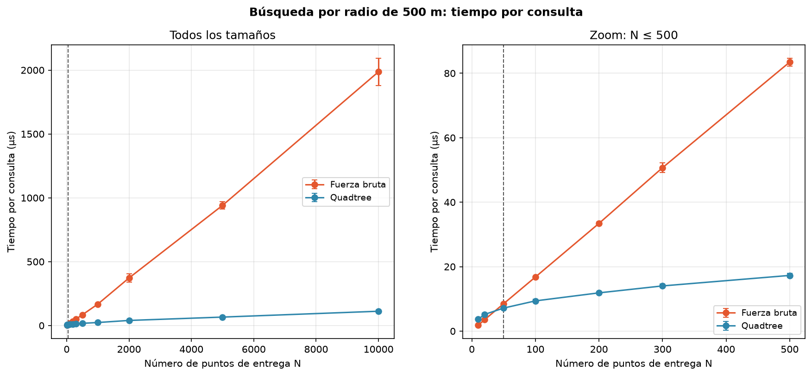
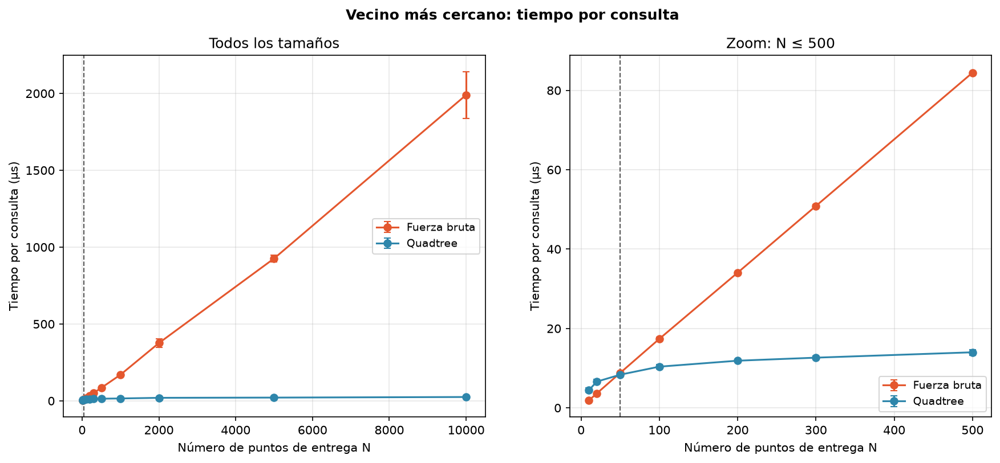
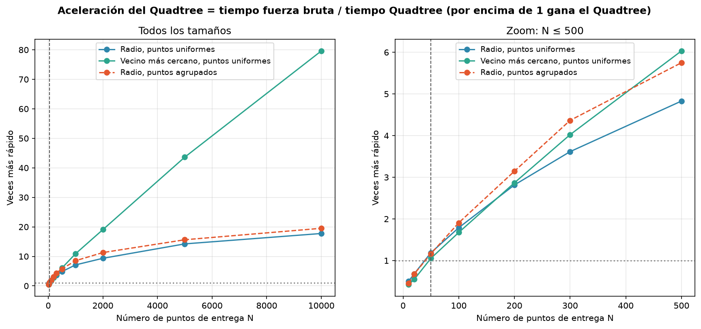
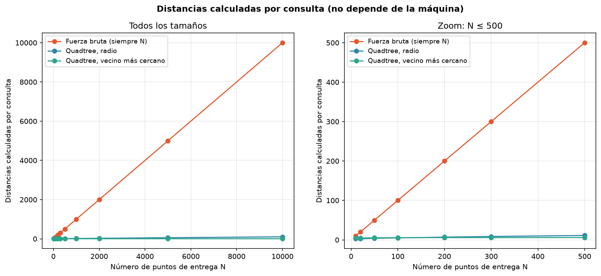
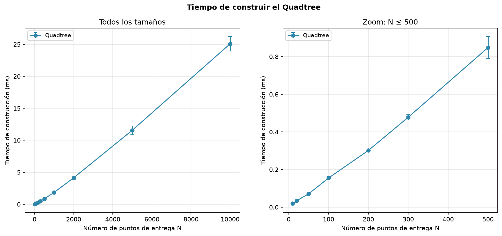
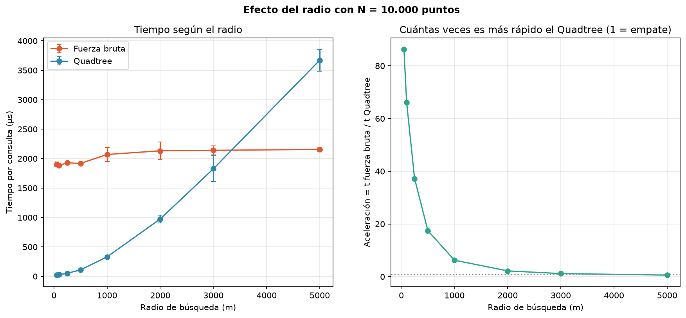

# Laboratorio 4 — Juan Manuel Moscoso Torres

Implementación de un Quadtree 2D desde cero para responder dos preguntas sobre 10.000 puntos de entrega: qué puntos están a 500 m o menos de una ubicación y cuál es el punto más cercano. Se compara con fuerza bruta, recorriendo una lista completa.

## Código de honor - Uso de Inteligencia Artificial

La implementación del Quadtree y la documentación de este laboratorio fueron diseñadas y escritas a mano. Utilicé **Claude (Anthropic)** únicamente como apoyo para ejecutar y revisar pruebas, analizar las mediciones y verificar la presentación de las gráficas. La responsabilidad de comprender, revisar y sustentar el código y los resultados es mía.

## 1. Contenido del repositorio

```
.
├── README.md
├── requirements.txt
├── Quadtreetree.py        <- Quadtree 2D, fuerza bruta y generadores de datos
├── test.py                <- pruebas unitarias, verificaciones visuales y análisis de las pruebas
├── analisis.py            <- métricas de rendimiento, gráficas e informe
├── graficas/              <- 9 gráficas PNG
├── resultados/            <- resultados_crudos.csv, informe_analisis.md, analisis_pruebas.txt
└── docs/                  <- material de estudio y de apoyo para la sustentación
```

## 2. Cómo ejecutarlo

Requiere Python 3.10+ y matplotlib.

```bash
pip install -r requirements.txt
python test.py
python analisis.py
```

- `python test.py` corre las 10 pruebas, imprime el análisis de las pruebas y genera las gráficas 01 a 03.
- `python analisis.py` mide los tiempos (un par de minutos) y genera las gráficas 04 a 09 y el informe. Los datos son reproducibles (semilla fija); lo que cambia entre equipos son los tiempos.

## 3. Cómo funciona

**Datos.** 10.000 puntos `(x, y)` generados al azar en un cuadrado de 10 km × 10 km. Las coordenadas están en **metros**, así que el radio de 500 es 500 m y las distancias salen en metros sin conversiones. Los puntos son estáticos.

**Quadtree.** Cada nodo cubre un rectángulo. Una hoja guarda hasta 4 puntos; al llegar al quinto se divide en 4 cuadrantes (SO, SE, NO, NE) y reparte sus puntos. Hay una profundidad máxima de 20 para que puntos repetidos no dividan para siempre.

**Búsqueda por radio.** Se baja por el árbol y se descarta todo nodo cuyo rectángulo queda más lejos que el radio. En las hojas que sobreviven se mide la distancia a cada punto.

**Vecinos más cercanos.** Se guarda una lista con los k mejores candidatos y se descarta todo nodo cuyo rectángulo está más lejos que el peor candidato. El más cercano es el caso k = 1.

**Distancias.** Se comparan distancias al cuadrado para no calcular raíces; el orden es el mismo. La raíz solo se aplica al devolver el resultado.

## 4. Pruebas y verificación visual (`test.py`)

Las pruebas comparan el Quadtree contra la fuerza bruta con miles de consultas, y revisan casos borde: árbol vacío, un solo punto, puntos repetidos, punto fuera del área, radio 0, consultas fuera de la ciudad y el triángulo 3-4-5 (un punto a exactamente 500 m entra, uno a 500,001 m no).







## 5. Análisis de rendimiento (`analisis.py`)

Se mide el tiempo por consulta con N entre 10 y 10.000, 10 repeticiones por tamaño y 200 consultas por repetición. Las gráficas usan ejes lineales y se incluye un zoom a los N pequeños, que es donde ocurre el cruce. Todas las tablas con números están en [resultados/informe_analisis.md](./resultados/informe_analisis.md).



La fuerza bruta crece con N porque revisa todos los puntos. El panel derecho permite ver el cruce en los tamaños pequeños.



Para el vecino más cercano el Quadtree poda más agresivamente después de encontrar un candidato bueno.



La línea punteada en 1 representa un empate. Por encima de 1 gana el Quadtree; en esta corrida el cruce fue N=50.



La fuerza bruta calcula N distancias. El Quadtree calcula muchas menos, aunque también paga el recorrido de nodos.



La construcción aumenta porque cada punto se inserta en el árbol. Como los datos son estáticos, este costo se paga una sola vez.



Con radios grandes se descartan menos cuadrantes y se devuelven más puntos; por eso la aceleración disminuye y finalmente la fuerza bruta gana.

### Respuesta a la pregunta del enunciado

En la corrida registrada en [resultados/informe_analisis.md](./resultados/informe_analisis.md), el Quadtree empezó a ser más rápido desde **N = 50** tanto para la búsqueda por radio como para el vecino más cercano; con N = 20 todavía perdía. Con N = 10.000 fue **17,8 veces** más rápido en radio y **79,6 veces** en vecino más cercano. Construir el árbol se pagó con unas **13 consultas** de radio.

Estos valores son propios de esta máquina y de esta ejecución. La conclusión reproducible es que la fuerza bruta gana con pocos puntos, mientras el Quadtree gana cuando puede descartar suficientes cuadrantes.

## 6. Documentación para estudiar y sustentar

- [Material para sustentar](./docs/MATERIAL_PARA_SUSTENTAR.md): metodología, resultados, lectura de cada gráfica y respuestas a preguntas.
- [Informe generado](./resultados/informe_analisis.md): tablas completas de la corrida.

## 7. Limitaciones

- Mediciones en Python puro y en un solo equipo: sirven para comparar tendencias, no tiempos absolutos.
- Una fuerza bruta vectorizada con NumPy sería mucho más rápida que la de listas; se compara con listas porque es lo que pide el enunciado.
- El cruce depende de la rejilla de N medida: el valor real está entre el último N donde el árbol pierde y el primero donde gana.
- Los datos son sintéticos (uniformes y agrupados), no coordenadas reales.
- Solo se implementó la versión 2D.
