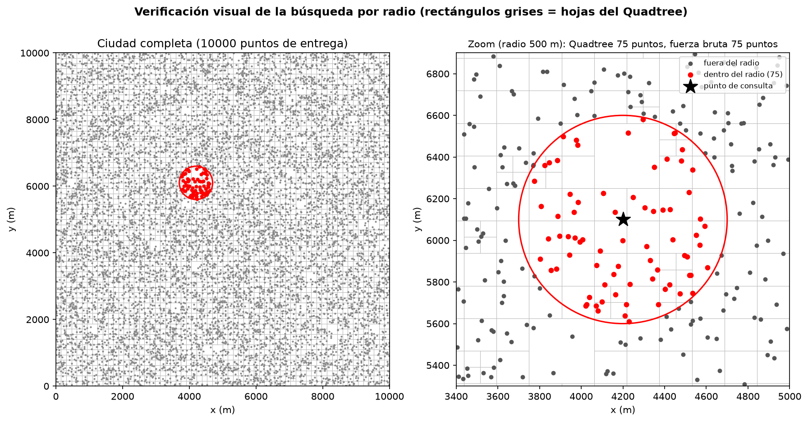
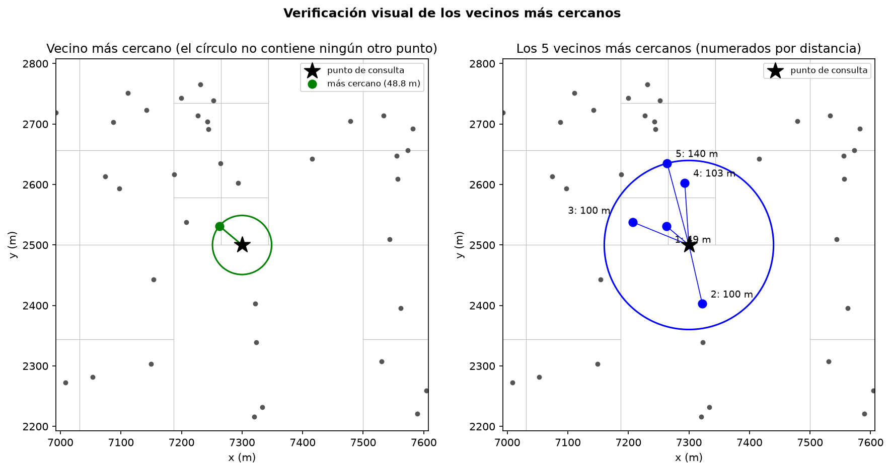
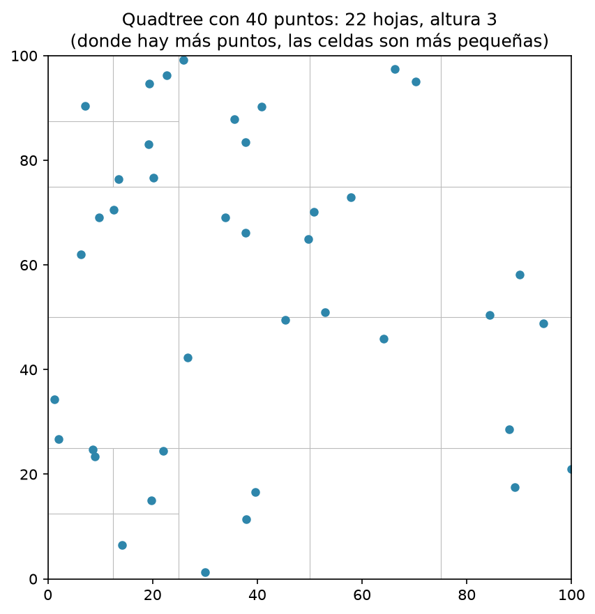
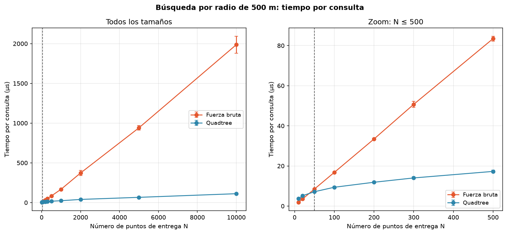
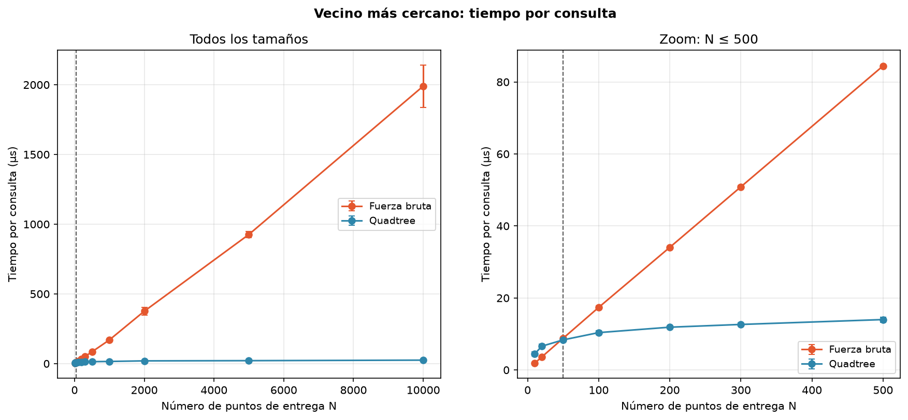
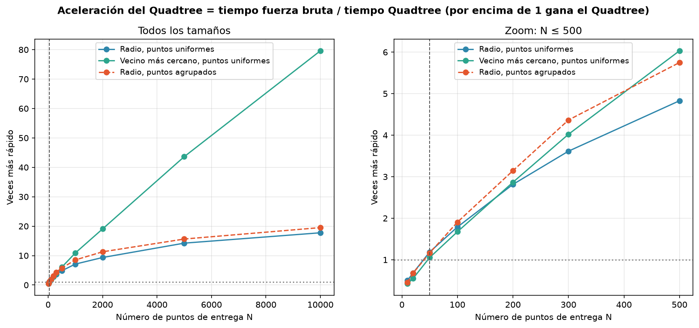
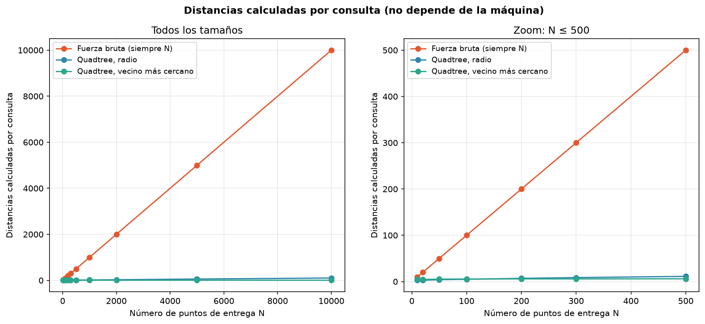
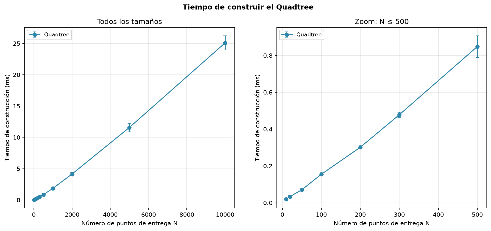
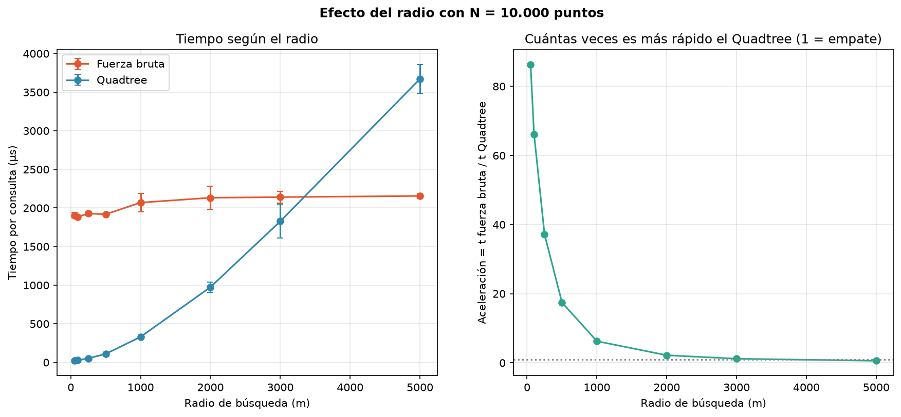

# Material para sustentar — Laboratorio 4

Este documento está organizado para mostrarlo durante la sustentación. Las cifras corresponden a la corrida guardada en [`resultados/informe_analisis.md`](../resultados/informe_analisis.md). Los tiempos pueden cambiar entre máquinas; las tendencias y la forma de las curvas son las conclusiones importantes.

## 1. Resumen en una página

**Problema.** Se tienen 10.000 puntos de entrega estáticos en una ciudad. El sistema debe responder:

1. ¿Qué puntos están a 500 m o menos de una ubicación?
2. ¿Cuál es el punto más cercano?

**Solución.** Se implementó un **Quadtree 2D** desde cero y se comparó con una búsqueda por **fuerza bruta** sobre una lista. También se verificó que ambos métodos devolvieran los mismos resultados.

**Resultado principal.** En esta corrida, el Quadtree empezó a ser más rápido desde `N = 50`, tanto para la búsqueda por radio como para el vecino más cercano. Con `N = 10.000` fue **17,8 veces más rápido** en la búsqueda por radio y **79,6 veces más rápido** al buscar el vecino más cercano.

**Explicación.** La fuerza bruta calcula la distancia contra los `N` puntos en cada consulta. El Quadtree descarta cuadrantes completos que no pueden contener una respuesta. Por ejemplo, con `N = 10.000`, la búsqueda por radio calculó aproximadamente **103 distancias** en el Quadtree frente a **10.000** en fuerza bruta.

El Quadtree no siempre gana: con pocos puntos, el costo de recorrer el árbol pesa más que el ahorro. Su ventaja aparece cuando hay suficientes puntos para que la poda sea significativa.

## 2. Qué contiene cada archivo

| Archivo | Contenido |
|---|---|
| [`Quadtreetree.py`](../Quadtreetree.py) | Quadtree 2D, búsquedas, fuerza bruta y generación de puntos |
| [`test.py`](../test.py) | Diez pruebas unitarias, comparaciones con fuerza bruta y tres gráficas de verificación |
| [`analisis.py`](../analisis.py) | Mediciones de tiempo, nueve gráficas, CSV e informe |
| [`resultados/informe_analisis.md`](../resultados/informe_analisis.md) | Tablas completas de la corrida |

## 3. Modelo y diseño

| Decisión | Justificación |
|---|---|
| **Coordenadas en 2D y en metros** | La ciudad se modela como un cuadrado de `10.000 m × 10.000 m`; por eso el radio de `500` se interpreta directamente en metros. |
| **Datos sintéticos uniformes** | Permiten controlar `N` y repetir el experimento. También se probó una distribución agrupada para simular barrios. |
| **Capacidad de 4 puntos por hoja** | Cuando una hoja recibe un quinto punto, se divide en cuatro cuadrantes. Es una regla sencilla y permite explicar la estructura. |
| **Profundidad máxima 20** | Evita dividir indefinidamente cuando hay puntos repetidos o muy cercanos. |
| **Distancia al cuadrado** | Mantiene el orden de las distancias y evita calcular raíces durante la búsqueda; la raíz solo se aplica al devolver resultados. |
| **Poda por distancia al rectángulo** | Si el punto más cercano de un cuadrante ya está fuera del radio, se descarta todo el cuadrante. Para vecinos, se compara con la peor distancia candidata. |
| **`<=` en el radio** | Un punto exactamente a 500 m sí pertenece a una búsqueda de “500 m o menos”; esto se verifica con el caso 3-4-5. |
| **Fuerza bruta con una lista** | Es la referencia directa solicitada: revisa todos los puntos y no usa estructuras espaciales adicionales. |
| **Datos estáticos** | El árbol se construye una vez y luego se reutiliza en muchas consultas; no se implementaron borrado ni actualización porque no son necesarios para el problema. |

## 4. Cómo se midió

- `N`: 10, 20, 50, 100, 200, 300, 500, 1.000, 2.000, 5.000 y 10.000 puntos.
- 200 consultas por repetición y 10 repeticiones por tamaño.
- Las mismas consultas se usaron para Quadtree y fuerza bruta.
- Se midió el tiempo **por consulta**, no el tiempo total de todas las consultas.
- Se desactivó temporalmente el recolector de basura para reducir ruido en las mediciones.
- Se midieron dos distribuciones: puntos uniformes y puntos agrupados.
- Las gráficas usan ejes lineales para mostrar la diferencia absoluta. En las gráficas de tiempo, el panel derecho hace zoom en `N ≤ 500`, donde ocurre el cruce.

## 5. Verificación de correctitud

### 5.1 Búsqueda por radio

*Figura 1. Puntos encontrados dentro del radio de consulta.*

El Quadtree y la fuerza bruta encuentran la misma cantidad de puntos. Los puntos rojos están dentro del círculo de radio; ningún punto fuera del círculo debe aparecer en el resultado.

### 5.2 Vecinos más cercanos

*Figura 2. Vecino más cercano y cinco vecinos más cercanos.*

La figura confirma que los puntos se ordenan por distancia. El círculo de referencia tiene como radio la distancia al vecino más lejano mostrado; no debe haber un punto omitido que esté más cerca.

### 5.3 Estructura del árbol

*Figura 3. Subdivisión espacial del Quadtree con 40 puntos.*

Cada nodo representa un rectángulo y se subdivide en cuatro. Las zonas con mayor concentración de puntos se subdividen más; esto permite buscar localmente en lugar de revisar toda la ciudad.

## 6. Resultados de rendimiento

### 6.1 Búsqueda por radio frente a `N`

*Figura 4. Tiempo promedio por consulta de radio de 500 m.*

La fuerza bruta crece casi linealmente porque siempre revisa los `N` puntos. El Quadtree crece mucho más lentamente porque descarta cuadrantes. En el zoom se observa que con `N = 20` todavía pierde y desde `N = 50` empieza a ganar.

### 6.2 Vecino más cercano frente a `N`

*Figura 5. Tiempo promedio por consulta del vecino más cercano.*

El Quadtree obtiene pronto un candidato y usa su distancia para podar más cuadrantes. Por eso la ventaja crece más que en la búsqueda por radio: en `N = 10.000` alcanza aproximadamente `79,6×`.

### 6.3 Aceleración

*Figura 6. Cociente entre el tiempo de fuerza bruta y el tiempo del Quadtree.*

La línea horizontal en `1` representa un empate. Por encima de la línea gana el Quadtree y por debajo gana la fuerza bruta. El cruce de ambas consultas está en `N = 50` en esta corrida.

### 6.4 Distancias calculadas

*Figura 7. Número promedio de distancias calculadas por consulta.*

Esta gráfica explica el origen de la mejora. La fuerza bruta calcula exactamente `N` distancias. Con `N = 10.000`, el Quadtree calcula cerca de 103 distancias para la búsqueda por radio; aun así, el tiempo no mejora 97 veces porque recorrer nodos y comparar rectángulos también tiene un costo.

### 6.5 Costo de construcción

*Figura 8. Tiempo necesario para construir el Quadtree.*

Construir el árbol tiene un costo inicial que aumenta con `N`. Como los puntos son estáticos, ese costo se paga una sola vez. Para `N = 10.000`, se recupera aproximadamente después de 13 consultas de radio.

### 6.6 Efecto del radio

*Figura 9. Tiempo y aceleración según el radio, con `N = 10.000`.*

Cuando el radio aumenta, más puntos deben devolverse y menos cuadrantes pueden descartarse. Por eso la aceleración disminuye: el Quadtree todavía gana con un radio de 3.000 m, pero con 5.000 m la fuerza bruta resulta más rápida.

## 7. Preguntas y respuestas

| Pregunta | Respuesta |
|---|---|
| ¿Qué método es mejor? | Depende de `N` y del radio. Con pocos puntos o radios muy grandes, la fuerza bruta puede ganar; con muchos puntos y una zona de consulta relativamente pequeña, gana el Quadtree. |
| ¿Desde qué tamaño gana el Quadtree? | Desde `N = 50` en las dos consultas medidas en esta corrida. El valor exacto depende de la máquina y de los tamaños evaluados. |
| ¿Por qué el vecino más cercano mejora más? | Después de encontrar un candidato, el algoritmo puede descartar rápidamente los cuadrantes cuya distancia mínima ya es peor que la del candidato. |
| ¿Por qué no siempre gana el Quadtree? | Tiene costos constantes: recorrer nodos, comparar rectángulos y mantener la estructura. Con pocos puntos, esos costos superan el ahorro. |
| ¿La construcción del árbol cuenta? | Sí, pero es un costo inicial. Con datos estáticos se construye una vez y se reutiliza; con unas 13 consultas de radio se amortiza para `N = 10.000`. |
| ¿Qué pasa si el radio aumenta? | Se descartan menos cuadrantes y se devuelven más puntos; la ventaja disminuye y puede desaparecer. |
| ¿Qué complejidad tiene cada método? | La fuerza bruta es `O(N)` por consulta. El Quadtree suele revisar muchos menos puntos, aunque su costo depende de la distribución, la profundidad y la cantidad de resultados. |
| ¿Cómo se comprobó que funciona? | Se compararon los resultados con fuerza bruta y se probaron árbol vacío, un punto, puntos repetidos, radio cero, consultas fuera de la ciudad y límites exactos del radio. |

## 8. Conclusiones y limitaciones

1. El Quadtree reduce el trabajo porque descarta regiones completas del espacio.
2. La ventaja se observa en las mediciones desde `N = 50` y es especialmente grande para vecinos más cercanos.
3. La fuerza bruta sigue siendo una buena referencia y puede ser preferible cuando `N` es pequeño o el radio cubre gran parte de la ciudad.
4. Los resultados son tendencias de una implementación en Python y de una máquina concreta, no tiempos universales.
5. Los datos son sintéticos y el modelo es 2D; no se están usando coordenadas geográficas reales ni distancia Haversine.
6. La comparación usa fuerza bruta con listas, no una versión vectorizada con NumPy, porque esa es la referencia del ejercicio.
